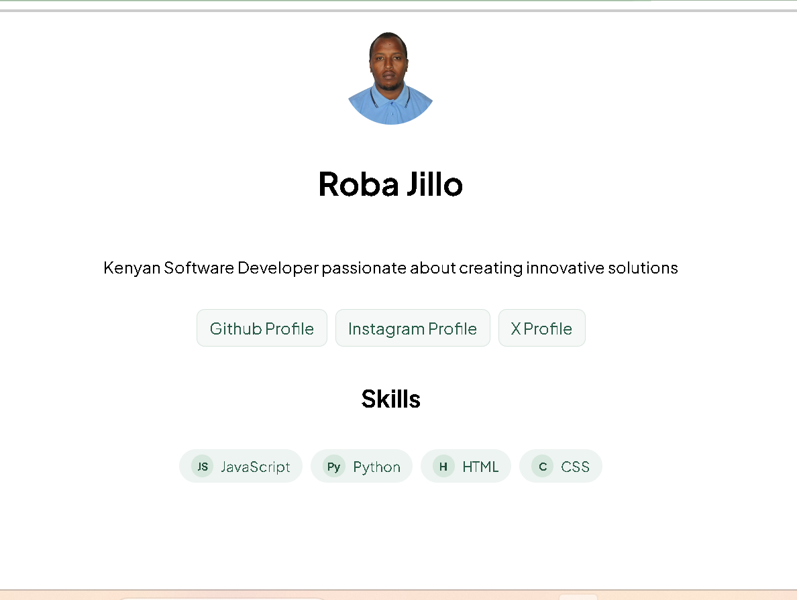

# Personal Profile Card 👤

A clean, responsive, single-page profile card built with semantic HTML5 and modern CSS techniques (Flexbox, Box Model, CSS variables, and micro-interactions).

## 🖼️ Screenshot



---

## 🚀 Key Concepts & Features

* **CSS Box Model:** Strict layout control using `box-sizing: border-box` to prevent unexpected padding overflows.
* **Flexbox Layout:** Vertical stacking for card structure and responsive `flex-wrap` layout for skill badges.
* **Custom Typography:** Integrated Google Font (*Inter*) for crisp text rendering.
* **Interactive Hover States:** Smooth CSS transitions on social links and interactive elements.
* **Responsive & Accessible:** Fully mobile-friendly layout with focus states for keyboard navigation.

---

## 🛠️ Tech Stack

* **HTML5:** Semantic markup (`<main>`, `<article>`, `<header>`, `<ul>`)
* **CSS3:** Custom properties, Flexbox layout, pseudo-classes (`:hover`, `:focus-visible`)

---

## 📋 User Stories Implemented

- [x] **Story 1: HTML Structure** — Semantic elements for profile image, name, bio, social links, and skill badges.
- [x] **Story 2: Layout & Typography** — Centered viewport positioning with `box-sizing: border-box` and custom Google Fonts.
- [x] **Story 3: Flex Alignment** — Vertical column stacking for main contents and wrapped flex container for badges.
- [x] **Story 4: Micro-Interactions** — Smooth hover effects and accessible focus styles across clickable links.

---

## 💻 Local Development Setup

1. **Clone the repository:**
   ```bash
   git clone [https://github.com/robajillo-prog/personal-profile-card.git](https://github.com/robajillo-prog/personal-profile-card.git)